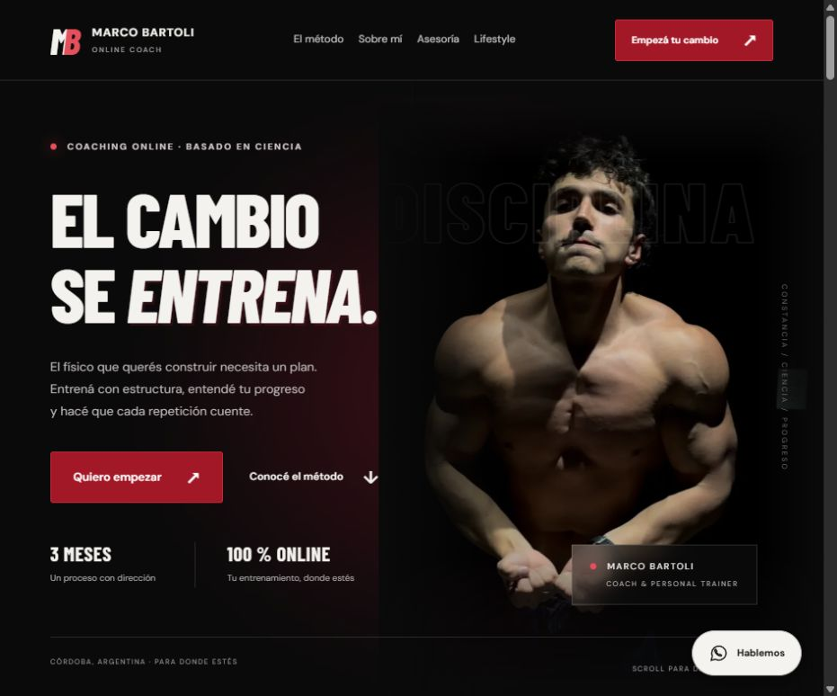
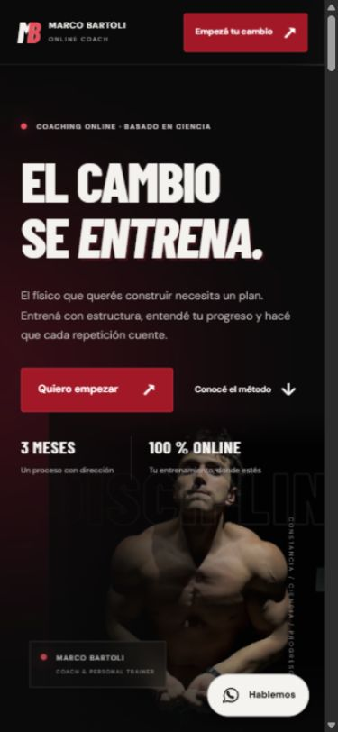
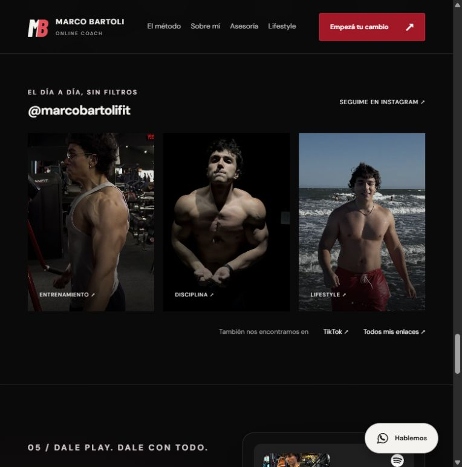
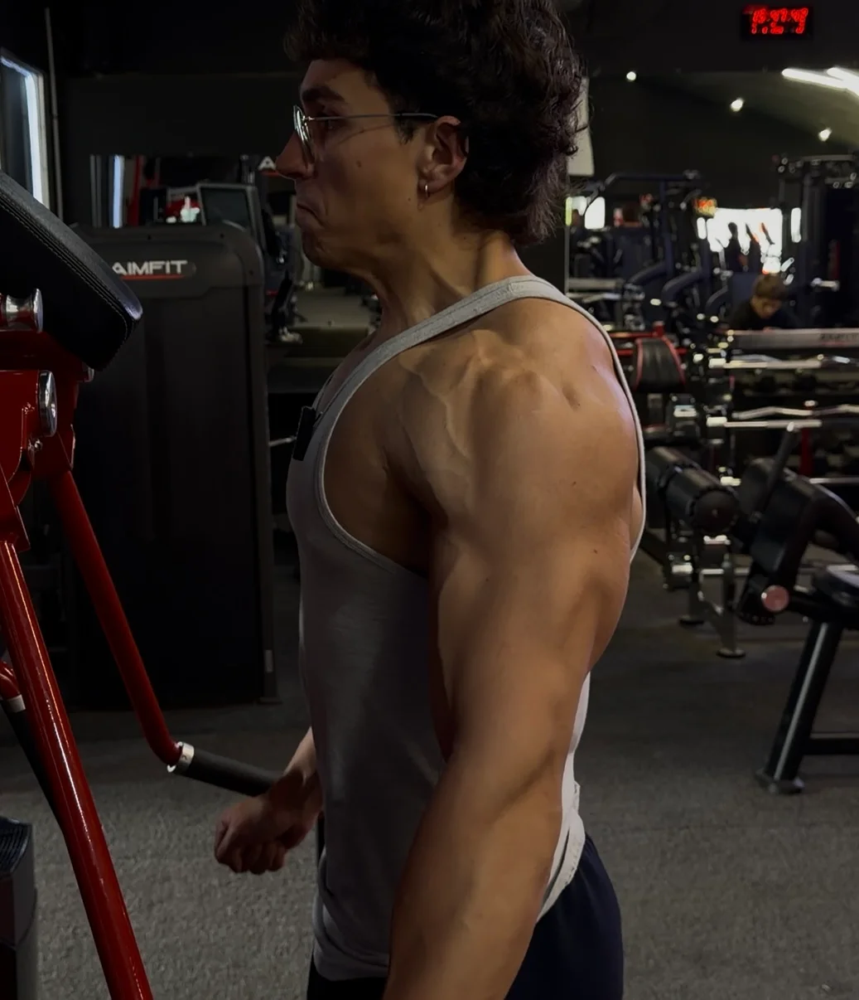
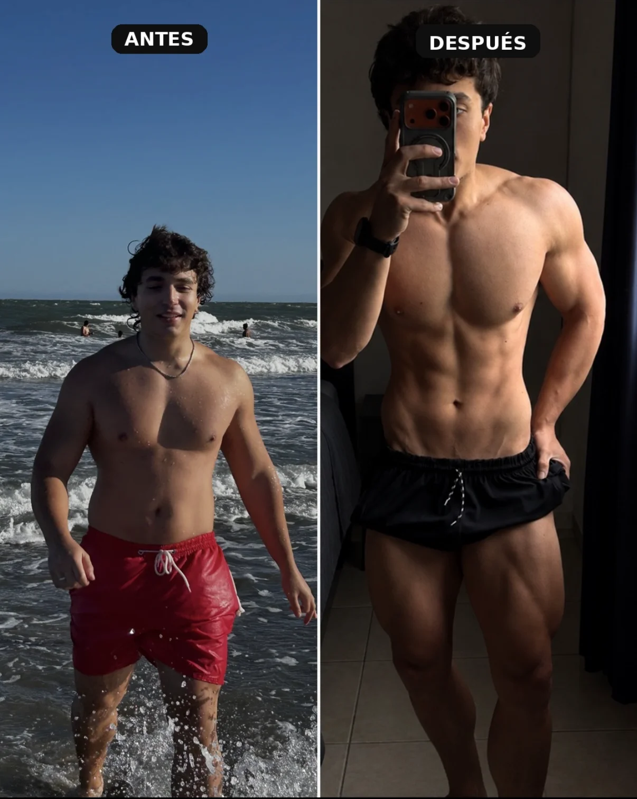

# Marco Bartoli · Entrená con propósito

Landing de coaching **100 % online**, con asesorías de **tres meses** y entrenamiento basado en ciencia. Identidad en negro, rojo oscuro y blanco, fotografías reales y una experiencia adaptable a celulares.

[Visitar el sitio](https://marcobartolifit.pages.dev/) · [Instagram](https://www.instagram.com/marcobartolifit/) · [YouTube](https://www.youtube.com/@MarcoBartoliFit) · [TikTok](https://www.tiktok.com/@marcobartolifit) · [WhatsApp](https://wa.me/5493516776352)



## Vista móvil



## La experiencia

- Presentación de Marco, cordobés de Argentina, coach y personal trainer.
- Método de trabajo, rutina estructurada y propuesta de tres meses exclusivamente online.
- Fotografías de entrenamiento y evolución personal, sin testimonios ni resultados inventados.
- Video «CAMBIÉ DE PREPARADOR | Road to UFA #1 ft. Benjamorano» y carrusel con los 24 Shorts públicos del canal, reproducibles en la página.
- Galería con acceso a Instagram, TikTok y Linktree.
- Reproductor de Spotify con la playlist **GYM LIFESTYLE**.
- Formulario inmediatamente debajo de Spotify, inspirado en el flujo de Cupido.
- WhatsApp flotante, preguntas frecuentes y frases motivadoras.



## Diseño y accesibilidad

Tipografía Barlow Condensed y DM Sans, luces ambientales animadas, tarjetas con transparencia y movimiento 3D sutil, títulos escalonados y entradas al desplazarse. Se evita sobrecargar la página con partículas.

Las animaciones respetan `prefers-reduced-motion`. Incluye navegación por teclado, etiquetas de formulario, estado accesible del envío, enlaces alternativos para los reproductores y textos alternativos en las fotografías. Los reproductores se cargan de forma diferida.

## Fotografías





- `media/originales/`: las ocho imágenes entregadas por el usuario, conservadas sin cambios, incluidos dos HEIC.
- `assets/fotos/`: seis versiones WebP optimizadas. Los recortes quitan márgenes negros de las capturas sin alterar el físico.
- `assets/redes/`: tres fotografías públicas y doce fotogramas recopilados previamente. Orígenes y limitaciones en [FUENTES.md](assets/redes/FUENTES.md).
- `assets/shorts/`: 24 miniaturas WebP y la lista verificada desde la pestaña pública de Shorts del canal el 18/10/2026.
- Los originales no se copian al sitio desplegado. Las imágenes siguen perteneciendo a sus titulares; recopilarlas no concede una licencia de reutilización a terceros.

## Desarrollo local

Se necesita Node.js 22 o posterior. No requiere dependencias de ejecución ni instalación de paquetes para construir.

```powershell
npm run check
npm test
npm run build
npm run dev
```

La vista local queda en `http://127.0.0.1:4173`. El formulario usa FormSubmit también en esta vista y una prueba puede enviar un correo real.

## Formulario y privacidad

El navegador envía el formulario directamente al endpoint AJAX de FormSubmit mediante el identificador opaco recibido en el correo de activación. FormSubmit confirmó una entrega de prueba con ese identificador el 18/10/2026. El correo real de destino no figura en el HTML, JavaScript ni en las solicitudes del navegador. `marco@gym.com` es el contacto visual solicitado, no un buzón configurado.

El endpoint anterior `/api/contact` permanece disponible como ruta heredada, pero la página ya no lo usa porque FormSubmit limitó con HTTP 429 los envíos originados desde Cloudflare. El Worker conserva sus validaciones y su secreto de destinatario para esa ruta. El formulario activo usa el campo trampa y las protecciones de FormSubmit. Una respuesta exitosa del proveedor no prueba por sí sola la entrega en la bandeja de entrada.

El formulario transmite los datos directamente a FormSubmit para responder la consulta. Spotify, YouTube y Google Fonts reciben las solicitudes necesarias para cargar su contenido. No hay analítica propia ni almacenamiento de consultas en una base de datos.

## Publicación

- Plataforma: Cloudflare Pages, proyecto `marcobartolifit`.
- Rama de producción: `release`.
- Salida: `dist/`.
- Configuración: `wrangler.jsonc` y secreto `CONTACT_RECIPIENT` para la ruta heredada.
- KV: binding `CONTACT_LIMITS` para la ruta heredada, separado del proyecto Cupido.

```powershell
npm run check
npm test
npm run build
npx wrangler pages deploy dist --project-name marcobartolifit --branch release
```

La publicación utiliza carga directa porque Cloudflare informó un error en la instalación de su integración Git. **Un push a GitHub no despliega automáticamente** hasta reparar y configurar esa integración o un flujo CI. No se guardan credenciales de Cloudflare o GitHub en el proyecto.

## Estructura

| Archivo o carpeta | Función |
| --- | --- |
| `index.html` | Contenido, secciones, SEO e integraciones |
| `styles.css` | Diseño adaptable, tipografía y animaciones |
| `script.js` | Entradas al scroll, tilt y formulario |
| `_worker.js` | Envío de consultas desde el servidor |
| `_headers` | Política de contenido y cabeceras de seguridad |
| `scripts/` | Construcción y servidor de vista local |
| `tests/contact.test.js` | Validación, límites y respuestas del proveedor |
| `docs/` | Capturas reales del sitio |

## Convención de commits

Mensajes en español: título descriptivo sin punto final, resumen de tres líneas y detalle concreto por archivo. No se usa Trello en este proyecto. Los archivos de texto mantienen CRLF mediante `.gitattributes`.
